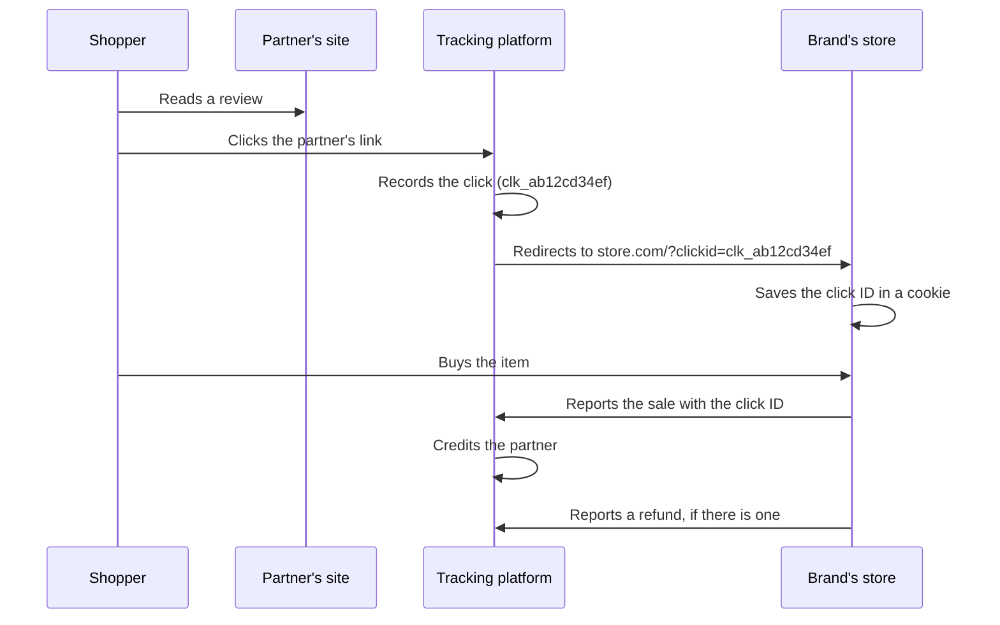

# Affiliate Tracking Sandbox

[](../../actions/workflows/tests.yml)


**A working model of how affiliate sales are tracked, and of the integration problems that break it.** It has a REST API for a tracking platform, a demo store that reports sales to it, switches that recreate the mistakes new clients make, a health check that finds those mistakes in a month of orders, and a troubleshooter that turns a client's message into a diagnosis and a reply.

**[Try the live demo](https://saialoor.github.io/affiliate-tracking-sandbox/)**: click a partner link, buy something, break the integration and find the problem. It runs in your browser.

| | |
| --- | --- |
| **Health check** | Found every one of 560 planted problems across 1,502 orders, in 9 issue types |
| **Biggest problem found** | Amounts sent in cents: $103,517 in commission overpaid in one month if left unfixed |
| **Troubleshooter** | Exact on error responses and requests; plain-English messages go to Claude (see [results](#latest-results)) |
| **Tests** | 31, including the real HTTP server and a check that the browser and Python versions agree |
| **Dependencies** | None to run. Python standard library and plain JavaScript |

> **Everything is fictional.** Juniper Supply Co. is a made-up store and the Sandbox Partner Platform is a made-up tracking platform. The month of orders is simulated, with known problems planted in it so every check can be scored.

## Contents

- [How affiliate tracking works](#how-affiliate-tracking-works)
- [What's in the project](#whats-in-the-project)
- [The problems it recreates](#the-problems-it-recreates)
- [Latest results](#latest-results)
- [The troubleshooter and where AI fits](#the-troubleshooter-and-where-ai-fits)
- [The REST API](#the-rest-api)
- [Decisions and tradeoffs](#decisions-and-tradeoffs)
- [Run it](#run-it)
- [Limits](#limits)

## How affiliate tracking works

A brand pays partners (bloggers, coupon sites, creators) a commission when a shopper they send buys something. The platform in the middle has to know which partner sent each shopper and what that shopper bought.



A store can report the sale two ways. A **browser tag** on the confirmation page is quick to add, but ad blockers and closed tabs can stop it. A **server-to-server API call** comes from the store's backend and nothing in the shopper's browser can block it. Most problems during onboarding come from the step between the click and the report: the click ID gets lost, the amount is in the wrong unit, or the refund is never sent.

## What's in the project

| Part | What it does | Where |
| --- | --- | --- |
| Platform API | Records clicks, validates and credits sales, drops duplicates, handles refunds, returns clear errors | `sandbox/server.py`, `sandbox/platform.py` |
| API contract | Required fields, formats and every error code with a plain-language message | `sandbox/contract.json` |
| Simulator | A month at Juniper Supply Co., run through the real platform logic, with mistakes planted | `sandbox/simulate.py` |
| Health check | Compares store orders with platform records, explains each gap and sizes the commission impact | `sandbox/healthcheck.py` |
| Troubleshooter | Turns an error, a request or an email into a likely cause, a fix and a reply | `sandbox/troubleshoot.py` |
| Playbook | For each problem: symptom, cause, how to confirm, fix and a client reply | `sandbox/playbook.json` |
| Live demo | The store, the platform, the switches, the health check and the troubleshooter in one page | `docs/index.html` |
| Integration guide | What a client's developer needs to set it up, with a go-live checklist | `docs/guide.html` |

The contract, playbook and troubleshooter rules are JSON files that both the Python code and the browser demo read, so they can't drift apart. A parity test checks that both give the same answers on the sample month and on every test message.

## The problems it recreates

| Problem | What the client sees | Usual cause | Fix |
| --- | --- | --- | --- |
| Click ID lost | Partner orders credited to nobody | A redirect drops `?clickid` | Keep it on every redirect and save it on landing |
| Amount in cents | Commissions 100 times too high | Checkout stores 8450, not 84.50 | Divide by 100 before sending |
| Wrong currency | Canadian sales look too high | USD hard-coded in the tag | Send the order's own currency |
| Sale never arrives | About 1 in 10 sales missing | Browser tag blocked | Add server-to-server reporting |
| Refunds not reported | Partners paid on returns | Reversal call never made | Call the reversal endpoint on refund |
| Duplicate reports | Same order sent twice | Tag fires again on reload | Already handled by order_id; fire once |
| Test orders in production | Fake sales pay commission | Live key used in testing | Use the test key; skip test orders |
| Rejected requests | 400 errors | A field in the wrong format | Fix the field the error names |
| Late sales | Sale rejected | Bought 31+ days after clicking | Working as designed |

## Latest results

Written by `python run.py` from the simulated October at Juniper Supply Co.

<!-- RESULTS:START -->
I compared 1,502 store orders (1,221 from partner traffic) with what the platform received.
7 issues need a fix. Left as is, partners would be overpaid by about $104,115 and underpaid by about $1,043 in commission for the month. 2 more are informational and need no change.

| Issue | Orders | Commission impact | Fix |
| --- | ---: | ---: | --- |
| Amount sent in cents | 158 | +$103,517 | Divide the amount by 100 before sending it, so it's in the currency's main unit. |
| Sale never reached the platform | 79 | -$536 | Add server-to-server reporting from the store's backend, which doesn't depend on the shopper's browser. |
| Click ID lost before checkout | 71 | -$507 | Keep the clickid parameter on every redirect, and save it in a first-party cookie or local storage on the first page the shopper sees. |
| Refunds not reported | 63 | +$320 | Call the reversal endpoint whenever an order is fully or partly refunded. |
| Wrong currency sent | 148 | +$262 | Send the order's own currency code on every conversion. |
| Test orders sent to production | 3 | +$16 | Use the test key while testing, and skip reporting for orders marked as tests. |
| Requests rejected by the API | 5 | $0 | Correct the field named in the error and resend. |
| Tag fires more than once | 29 | $0 | Already handled: the platform dropped the extra copies. Optional cleanup: fire the tag once per order. |
| Sale outside the lookback window | 4 | $0 | Working as designed: these sales fell outside the 30-day lookback window. |

A positive impact means partners would be overpaid; negative means underpaid. Commission is figured at 8% of the sale, converted to US dollars.

**How well the health check finds the planted problems**

| Problem | Planted | Flagged | Correct | Precision | Recall |
| --- | ---: | ---: | ---: | ---: | ---: |
| Amount sent in cents | 158 | 158 | 158 | 100% | 100% |
| Click ID lost before checkout | 71 | 71 | 71 | 100% | 100% |
| Sale never reached the platform | 79 | 79 | 79 | 100% | 100% |
| Wrong currency sent | 148 | 148 | 148 | 100% | 100% |
| Tag fires more than once | 29 | 29 | 29 | 100% | 100% |
| Sale outside the lookback window | 4 | 4 | 4 | 100% | 100% |
| Refunds not reported | 63 | 63 | 63 | 100% | 100% |
| Test orders sent to production | 3 | 3 | 3 | 100% | 100% |
| Requests rejected by the API | 5 | 5 | 5 | 100% | 100% |

**How well the troubleshooter's rules diagnose messages they were never tuned on**

| Input | Messages | Correct |
| --- | ---: | ---: |
| Structured | 3 | 3 |
| Plain text | 9 | 0 |
<!-- RESULTS:END -->

## The troubleshooter and where AI fits

The troubleshooter reads three kinds of input:

1. **An error the API returned**, like `{"error": {"code": "invalid_click_id"}}`
2. **The request a client sent**, like `{"amount": 8450, ...}`
3. **What the client wrote**, like "our refunds still show as approved"

For the first two, rules are the right tool. The error code or the request's fields name the problem exactly, using the same contract the API enforces. On messages the rules were never tuned on, they got every structured input right.

Plain-English messages are different. I wrote 30 test messages and tuned the rules on them, then wrote 12 more afterward and never changed the rules again. The rules got none of the 9 plain-English messages in that second set right, because clients describe the same problem in many different words. "Customer sends something back" means a refund, but no keyword list catches every way of saying it.

That's where AI earns its place. With `--ai`, plain-English messages go to Claude with the playbook's list of known issues, and it must pick one from that list. Its answer is checked against the list, so it can't invent a cause. Structured inputs never go to the model, and without an API key everything falls back to the rules. The tests cover this path with a stand-in for Claude's API. To score it against the real model, run `python -m sandbox.evaluate --ai` with your own key.

```bash
python -m sandbox.troubleshoot '{"click_id": "clk_ab12cd34ef", "order_id": "A-5531", "amount": 8450, "currency": "USD"}'
# Likely cause: Amount sent in cents  (because amount 8450 has no decimal point and looks like cents)

ANTHROPIC_API_KEY=... python -m sandbox.troubleshoot --ai "We moved checkout to a subdomain and nothing is attributed"
```

## The REST API

Run it with `python -m sandbox.server` (no installs needed). The live key is `live_demo_9f2c41`.

| Method | Endpoint | Purpose |
| --- | --- | --- |
| GET | `/r/{partner_id}?to=<url>` | Partner link: records a click and redirects with `?clickid=` |
| POST | `/v1/conversions` | Report a sale from your server (needs `Authorization: Bearer <key>`) |
| GET | `/v1/tag.gif?click_id=&order_id=&amount=&currency=` | Report a sale from the browser; always returns an image |
| POST | `/v1/conversions/{order_id}/reversal` | Report a full or partial refund |
| GET | `/v1/conversions` | List recorded sales |
| GET | `/v1/errors` | List rejected requests |

```bash
curl -X POST localhost:8008/v1/conversions \
  -H "Authorization: Bearer live_demo_9f2c41" -H "Content-Type: application/json" \
  -d '{"click_id": "clk_ab12cd34ef", "order_id": "JS-1", "amount": 84.50, "currency": "USD"}'
```

Every error names the field and the fix, for example: *"amount is over 100,000. If the value is in cents, divide by 100 before sending."* The full list is in the [integration guide](https://saialoor.github.io/affiliate-tracking-sandbox/guide.html#errors).

## Decisions and tradeoffs

**Error messages written for the person reading them.** A developer seeing `amount_too_large` at 11pm should learn the likely cause from the message itself. Most onboarding tickets start with an error someone didn't understand.

**The tag always returns an image.** A tracking pixel that returns an error page can break a checkout. The result goes in a response header instead, where a developer can find it.

**Duplicates are dropped by order_id, not by time.** Stores often report the same sale from both the browser and the server. Matching on the order ID makes that safe, and the health check reports duplicates as handled rather than as a fault.

**Commission impact in dollars, not error counts.** "158 orders sent in cents" doesn't tell a client what's urgent. "$103,517 in overpaid commission" does, and it puts that problem first.

**Rules where they're exact, AI where they aren't.** I measured where the rules fail before adding AI, kept the model inside a fixed list of causes, and kept it away from inputs the rules already handle perfectly.

**One set of rules for Python and the browser.** The demo had to run on a static page, so the logic exists twice. Shared JSON files and a parity test keep the two from drifting.

## Run it

```bash
python run.py                    # simulate the month (if needed), run the health check, write the reports
python -m sandbox.server         # start the REST API on localhost:8008
python -m sandbox.troubleshoot "orders that were returned still show as approved"
python -m sandbox.evaluate       # score the troubleshooter (add --ai with ANTHROPIC_API_KEY)
pip install pytest && pytest -q  # 31 tests
```

For the demo locally, run `python -m http.server` inside `docs/` and open `localhost:8000`.

```
affiliate-tracking-sandbox/
├── run.py                     runs the simulation, health check and reports
├── sandbox/
│   ├── platform.py            clicks, conversions, duplicates, refunds (SQLite)
│   ├── server.py              REST API, standard library only
│   ├── simulate.py            a month of orders with planted problems
│   ├── healthcheck.py         store vs platform comparison and commission impact
│   ├── troubleshoot.py        rules and optional Claude diagnosis
│   ├── evaluate.py            troubleshooter scorecard
│   ├── contract.json          API fields and error codes
│   ├── playbook.json          problems, causes, fixes and client replies
│   └── rules.json             troubleshooter rules
├── data/                      the simulated month
├── outputs/                   health check report, findings and scorecards
├── docs/                      live demo, integration guide and the browser engine
└── tests/                     31 tests and the troubleshooter test messages
```

## Limits

- **The data is simulated,** so the health check's perfect score shows it finds the problems it was built for. Real client data would bring new ones.
- **The troubleshooter's plain-English accuracy depends on the AI mode,** which needs an API key. The rules alone handle structured inputs only.
- **The platform is a model, not a product.** It has no partner payouts, fraud checks or multi-touch attribution.
- **Fixed exchange rates** are used for the demo's commission figures.

## Author

**Sai Soumya Aloor**  
saialoor@outlook.com

Licensed under the MIT License.
